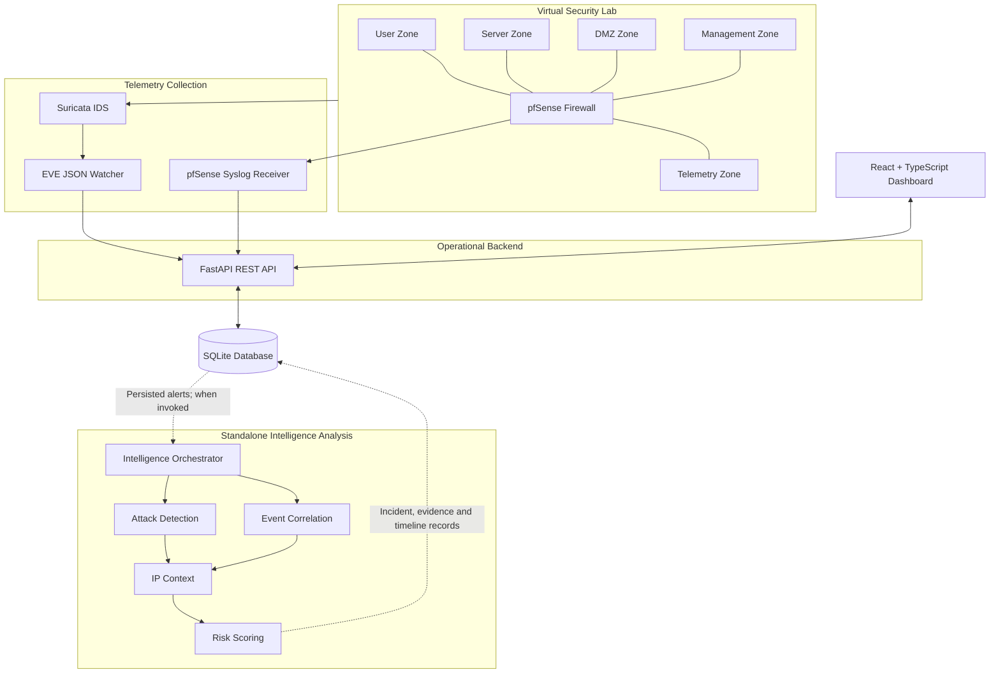

# ZTShield — System Architecture

## 1. Introduction

ZTShield (Zero-Trust Network Defense & Attack Simulation Platform) is a
network security monitoring and attack simulation platform designed to
demonstrate zero-trust security principles in a controlled virtual lab.

The platform collects network telemetry, ingests and stores security events,
provides separately implemented intelligence analysis modules, and presents
monitoring data through a centralized dashboard.

## 2. High-Level Architecture

The platform consists of five primary layers:

1. **Network and Security Layer** — pfSense firewall and isolated lab zones.
2. **Telemetry Collection Layer** — Suricata IDS and pfSense syslog events.
3. **Backend Processing Layer** — FastAPI ingestion APIs and separately invokable intelligence analysis modules.
4. **Data Persistence Layer** — SQLite database.
5. **Presentation Layer** — React and TypeScript dashboard.

## 3. Architecture Diagram

## 4. Network and Security Layer

The virtual lab uses pfSense to control communication between network zones.

| Zone | Subnet | Purpose |
|---|---|---|
| USER | 192.168.10.0/24 | User-side lab systems |
| SERVER | 192.168.20.0/24 | Internal server systems |
| DMZ | 192.168.30.0/24 | Externally exposed test services |
| MANAGEMENT | 192.168.40.0/24 | Administrative access and management |
| TELEMETRY | 192.168.56.0/24 | Security monitoring and telemetry |

pfSense enforces inter-zone firewall policies. Communication is controlled
through explicit rules rather than assuming that all internal networks are
trusted.

## 5. Telemetry Collection Layer

### 5.1 Suricata IDS

Suricata monitors network traffic and generates security events in EVE JSON
format.

ZTShield uses a custom detection rule file:

`detection/ztshield.rules`

The configured EVE log is monitored by:

`backend/watch_eve.py`

The watcher reads new events and forwards them to the backend ingestion API.

### 5.2 pfSense Syslog

The pfSense syslog receiver accepts firewall telemetry and forwards
normalized events to the backend.

Implementation:

`backend/pfsense_syslog_receiver.py`

### 5.3 Ingestion Interfaces

| Source | Backend endpoint |
|---|---|
| Suricata | POST /api/ingest/suricata |
| pfSense | POST /api/ingest/pfsense |

Ingestion requests use token-based authentication configured through backend
environment settings.

## 6. Backend Processing Layer

The backend is implemented using Python and FastAPI.

Main application:

`backend/main.py`

The backend provides REST endpoints for health checks, alerts, incidents,
event ingestion, dashboard summaries, and sensor information.

### 6.1 Intelligence Modules

ZTShield includes a separately implemented intelligence analysis capability
under `backend/intelligence/`. These modules are tested independently and
are coordinated by the orchestration module when explicitly invoked.

| Module | Source file | Responsibility |
|---|---|---|
| Attack Detection | `backend/intelligence/attack_detection.py` | Identifies security attack patterns in events |
| Event Correlation | `backend/intelligence/event_correlation.py` | Identifies relationships between security events |
| IP Context | `backend/intelligence/ip_context.py` | Classifies communication scope using IP context |
| Risk Scoring | `backend/intelligence/risk_scoring.py` | Assesses the risk associated with detected candidates |
| Orchestrator | `backend/intelligence/orchestrator.py` | Coordinates analysis and incident creation |

The orchestrator exposes `process_alerts()`. It reads persisted alerts,
builds analysis candidates through attack detection and event correlation,
evaluates communication context and risk, and can create or update incidents,
evidence records, and timeline events.

Attack detection and event correlation are separate analysis branches within
the orchestrator; they are not sequential stages of the live ingestion API.

**Integration status:** The intelligence modules have dedicated automated
tests. However, the current application code does not invoke
`process_alerts()` from the FastAPI ingestion flow. Therefore, this capability
is documented as a standalone, explicitly invoked analysis component rather
than an automatically executed stage of live telemetry ingestion.

## 7. Data Persistence Layer

ZTShield uses SQLite for local data persistence.

The database stores application security data, including ingested alerts and
incident records.

The backend uses SQLAlchemy for database interaction.

The local database is:

`backend/ztshield.db`

This file is generated locally and should not be committed to a public
repository.

## 8. Presentation Layer

The frontend is implemented using:

- React
- TypeScript
- Vite
- Lucide React

The dashboard communicates with the FastAPI backend through HTTP REST
requests.

Local development configuration:

`http://127.0.0.1:8000`

Frontend source:

`frontend/src/App.tsx`

The dashboard presents security alerts, event summaries, sensor information,
and other monitoring information exposed by the backend.

## 9. Security Controls

The architecture demonstrates the following security controls:

- Network segmentation using pfSense.
- Inter-zone traffic control through firewall policies.
- Intrusion detection using Suricata.
- Authenticated telemetry ingestion.
- Centralized security event storage.
- Monitoring through a centralized dashboard.
- Controlled attack simulation in an isolated lab.

## 10. Validation Evidence

The following implementation checks have been completed:

| Validation | Result |
|---|---|
| Backend API health check | Passed |
| SQLite connectivity through health endpoint | Passed |
| Backend automated tests | 64 passed |
| Frontend production build | Passed |
| Suricata live event ingestion | Verified |
| Suricata event persistence | Verified |
| Authenticated pfSense event ingestion | Verified |
| Management-to-DMZ SSH access | Verified |
| DMZ-to-Management SSH blocking | Verified |

## 11. Deployment Scope and Limitations

ZTShield is a local-development and controlled-lab platform.

The current frontend API configuration uses the local loopback address.
Deployment on separate machines requires appropriate API endpoint and network
configuration.

The platform should be evaluated within its configured virtual lab. It is not
presented as a production-ready enterprise SIEM or a substitute for a
dedicated security operations platform.

## 12. Conclusion

ZTShield combines firewall enforcement, intrusion detection, authenticated
telemetry ingestion, database persistence, dashboard visualization, and
separately implemented intelligence analysis capabilities in a centralized
zero-trust security monitoring platform.
